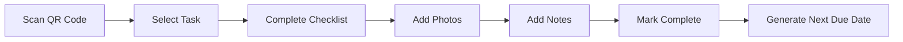
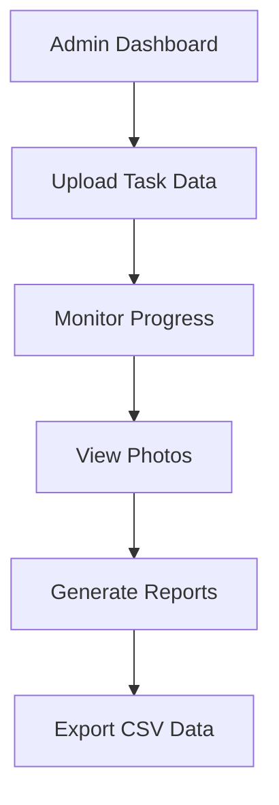

# CheckMate - Smart Maintenance Management System

<div align="center">
  <h1>🔧 CheckMate</h1>
  <p><strong>Smart Maintenance Management System</strong></p>
  <p>A production-ready maintenance management application designed for manufacturing and industrial environments</p>
  
  
  
  [](https://256036beb769409f972f8c053566049e-65b17a73b50d4fceac0874450.fly.dev/login)
  [](https://github.com/udayputtireddi/checkmate)
</div>

## ✨ Features

### 🏭 **Production-Ready Maintenance Management**
- **Smart Task Scheduling** - Automated daily, weekly, and monthly maintenance schedules
- **QR Code Machine Integration** - Instant machine identification and task access
- **Photo Documentation** - Attach photos to completed maintenance tasks
- **Real-time Progress Tracking** - Save and resume task progress
- **Mobile-First Design** - Optimized for tablets and mobile devices

### 👥 **Role-Based Access Control**
- **Admin Dashboard** - Complete system oversight and management
- **Operator Interface** - Simplified task-focused experience
- **Dynamic User Registration** - Automatic account creation based on email patterns
- **Department Management** - Organize users by production departments

### 📊 **Advanced Reporting & Analytics**
- **Task Performance Reports** - Completion rates and timing analysis
- **Photo Log Reports** - Visual documentation tracking
- **Maintenance Schedules** - Upcoming and overdue task reports
- **Machine Efficiency** - Performance metrics by equipment
- **CSV Export** - All reports exportable for external analysis

### 📱 **Mobile-Optimized Experience**
- **Responsive Design** - Works seamlessly on phones, tablets, and desktops
- **Touch-Friendly Interface** - Optimized for industrial tablet use
- **Offline-Ready** - Local storage for reliable operation
- **Progressive Web App** - Install on mobile devices like a native app

## ��� Tech Stack

### **Frontend**
- **React 18** with TypeScript
- **Vite** for fast development and building
- **TailwindCSS** for responsive styling
- **React Router** for navigation
- **Lucide React** for icons

### **Backend & Data**
- **Node.js** server architecture
- **LocalStorage** for client-side data persistence
- **Base64 encoding** for photo storage
- **CSV generation** for reports

### **Deployment**
- **Firebase Hosting** for production deployment
- **GitHub Actions** for CI/CD

## 🚀 Quick Start

### Prerequisites
- Node.js 18+
- npm or yarn package manager

### Installation

1. **Clone the repository**
   ```bash
   git clone https://github.com/udayputtireddi/checkmate.git
   cd checkmate
   ```

2. **Install dependencies**
   ```bash
   npm install
   ```

3. **Start development server**
   ```bash
   npm run dev
   ```

4. **Open your browser**
   Navigate to `http://localhost:5173`

### Production Build
```bash
npm run build
npm run preview
```

## 🎯 Usage Guide

### **For Operators**
1. **Login** with your company email (e.g., `operator@company.com`)
2. **Scan QR codes** on machines to access tasks
3. **Complete maintenance checklists** with photo documentation
4. **Save progress** for tasks that can't be completed immediately

### **For Administrators**
1. **Login** with admin credentials (e.g., `admin@company.com`)
2. **Upload maintenance schedules** via Excel import
3. **Monitor task completion** in real-time
4. **View photos and documentation** from completed tasks
5. **Generate reports** for performance analysis

### **Demo Accounts**
- **Admin**: `admin@company.com` (any password)
- **Operator**: `operator@company.com` (any password)

## 📋 Core Workflows

### **Task Completion Process**


### **Admin Management**


## 🎨 Screenshots

<details>
<summary>🖼️ View Application Screenshots</summary>

### Login Screen


### Operator Dashboard


### Task Completion


### Admin Dashboard


### Photo Gallery


### Mobile View


</details>

## 🏗️ Project Structure

```
checkmate/
├── client/                 # Frontend React application
│   ├── components/         # Reusable UI components
│   ├── pages/             # Application pages/routes
│   ├── lib/               # Utilities and services
│   └── hooks/             # Custom React hooks
├── server/                # Backend server code
├── public/                # Static assets
├── dist/                  # Production build output
└── README.md             # Project documentation
```

## 🔧 Configuration

### **Environment Variables**
Create a `.env` file in the root directory:
```env
# Development
VITE_API_URL=http://localhost:3000
VITE_APP_NAME=CheckMate

# Production
VITE_API_URL=https://your-api-domain.com
```

### **Firebase Deployment**
1. Install Firebase CLI: `npm install -g firebase-tools`
2. Login: `firebase login`
3. Deploy: `firebase deploy`

## 📈 Performance Features

- **⚡ Lightning Fast** - Vite-powered development and building
- **📱 Mobile Optimized** - 100% responsive design
- **🔄 Real-time Updates** - Instant task status synchronization
- **💾 Offline Ready** - LocalStorage for reliable data persistence
- **📊 Smart Caching** - Optimized data loading and storage

## 🧪 Testing

```bash
# Run all tests
npm test

# Build and test production bundle
npm run build
npm run preview
```

## 🚀 Deployment

### **Firebase Hosting** (Current Deployment)
```bash
npm run build
firebase deploy
```

The project is currently deployed and hosted on Firebase. For alternative hosting platforms, build the project and deploy the `dist/` folder to your preferred provider.

## 🤝 Contributing

We welcome contributions! Here's how to get started:

1. **Fork the repository**
2. **Create a feature branch**: `git checkout -b feature/amazing-feature`
3. **Commit your changes**: `git commit -m 'Add amazing feature'`
4. **Push to the branch**: `git push origin feature/amazing-feature`
5. **Open a Pull Request**

### **Development Guidelines**
- Follow TypeScript best practices
- Use TailwindCSS for styling
- Maintain mobile-first responsive design
- Add proper error handling
- Write meaningful commit messages

## 🐛 Issue Reporting

Found a bug or have a feature request? Please create an issue:

1. **Check existing issues** to avoid duplicates
2. **Use the issue template** when creating new issues
3. **Provide detailed information** including steps to reproduce
4. **Add screenshots** if applicable

## 📄 License

This project is licensed under the MIT License - see the [LICENSE](LICENSE) file for details.

## 🙏 Acknowledgments

- **React Team** for the amazing framework
- **Tailwind CSS** for the utility-first CSS framework
- **Lucide** for the beautiful icon set
- **Vite** for the blazing fast build tool

## 📞 Support

- **Documentation**: [GitHub Wiki](https://github.com/udayputtireddi/checkmate/wiki)
- **Issues**: [GitHub Issues](https://github.com/udayputtireddi/checkmate/issues)
- **Discussions**: [GitHub Discussions](https://github.com/udayputtireddi/checkmate/discussions)

---

<div align="center">
  <p>Made with ❤️ for modern manufacturing</p>
  <p><strong>CheckMate - Smart Maintenance Management System</strong></p>
</div>
